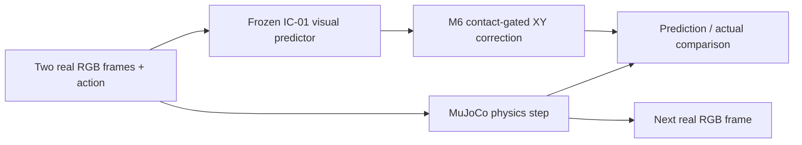

# ActionWorld Lite

**A lightweight, action-conditioned visual world model for physical interaction.**

[**Try the live demo**](https://actionworld-lite.vercel.app) · [Architecture](docs/architecture.md) · [Research results](docs/evaluation.md) · [Documentation](docs/README.md)

ActionWorld Lite studies whether a compact learned model can predict the next physical state of a T-shaped object from **two real RGB observations and a commanded pusher action**. A MuJoCo simulator executes the same action afterward, allowing a direct comparison between the model's prediction and the physical reference. The interactive web demo runs real CPU inference and headless MuJoCo on Vercel Hobby; it does not replay prerecorded trajectories.

**Release scope:** A scene-specific, one-step research demonstrator—not a general-purpose world model, an autonomous robot controller, or an AI video generator. The production deployment has passed its recorded functional checks. M8 final engineering acceptance remains **CONDITIONAL**, with x86_64 restore-versus-continuous parity and direct Vercel memory measurement unverified and the first Preview stage skipped. See [deployment record](docs/M8_STEP3_DEPLOYMENT.md).

## Key highlights

- **Real visual prediction.** The frozen IC-01 model uses consecutive 64 × 64 RGB frames and a 2D action to estimate the current object pose, next pose, displacement, and endpoint contact. It does not receive privileged simulator state as an inference input.
- **Contact-aware residual correction.** M6 adds a TRAIN-fitted, predicted-contact-gated ridge residual to IC-01's XY displacement; correction magnitude is capped at **4 mm**. The model weights from M4 remain frozen.
- **Measured research, with split boundaries.** On M6's one-pass **VALIDATION** evaluation (1,701 windows), mean motion error changed from **0.156625 cm** (IC-01) to **0.135983 cm** (M6), approximately **13.18% lower**. This is not an independent M6 TEST result or a guarantee for individual live actions.
- **Real physics and inspectable behavior.** Each accepted action triggers one IC-01 inference and one 0.05 s MuJoCo control step; the next RGB image is rendered by **MuJoCo**, not synthesized by the network.
- **Live, CPU-only deployment.** FastAPI, PyTorch, MuJoCo and OSMesa run in a Vercel Container; stateless signed tokens carry each browser session's physics snapshot and two input frames.
- **Evidence-first engineering.** Frozen checkpoints are hash-verified, sensitive runtime artifacts are excluded from Git, and original TEST and milestone acceptance records remain unchanged.

## See it in action

Open [actionworld-lite.vercel.app](https://actionworld-lite.vercel.app), select a **5, 10, or 20 mm** step, and move the pusher **up, down, left, or right**. The interface shows the real scene, IC-01 and M6 predicted XY states, actual state, and prediction errors. **Reset** starts a new scene.

The browser demo is public; the trained checkpoints and fitted M6 runtime JSON are **not distributed through this Git repository**. A fresh clone is therefore not a plug-and-play reproduction of live inference. See [local usage and reproduction boundaries](docs/usage.md).

## System at a glance

IC-01 predicts **state**, not next-frame pixels. The M6 head corrects XY only; yaw and contact prediction come from IC-01. Read the [architecture](docs/architecture.md) and [model specification](docs/models.md) for the exact boundaries.

## Selected results

| Evidence scope | Result | Interpretation |
| --- | --- | --- |
| M4 one-time held-out **TEST**, 1,701 windows | IC-01 mean next-XY error **0.339025 cm**; contact F1 **0.958378** | One-step prediction on the fixed PushT simulation family; TEST was used once |
| M6 one-pass **VALIDATION**, 1,701 windows | Mean motion error **0.156625 → 0.135983 cm** | About **13.18% lower** for the tested validation distribution, not a new TEST |
| M8 Production acceptance, 2026-10-26 | **479/479** general checks and **416/416** contact-run checks | Recorded assertions from deployment acceptance scripts, not 895 independent test cases |
| M8 Production responsiveness | **1.05 s** median action response | Measured on the recorded Production run; cold resets were slower |

**Important counterexample:** In the recorded M8 live contact sequence, M6's mean motion error was **0.744 cm**, worse than IC-01's **0.529 cm**. The project reports this rather than treating aggregate VALIDATION gains as universal improvements.

Read [Evaluation & results](docs/evaluation.md) for methods, controls, provenance, negative results, and limitations.

## Documentation

| Read this | For |
| --- | --- |
| [Documentation index](docs/README.md) | All guides, research reports and immutable records |
| [Architecture](docs/architecture.md) | End-to-end request, inference, physics and session flow |
| [Models](docs/models.md) | IC-01, M6, model inputs/outputs and frozen artifacts |
| [Evaluation](docs/evaluation.md) | One-time TEST, VALIDATION and online acceptance evidence |
| [Usage](docs/usage.md) | Live demo, local checks and fresh-clone constraints |
| [API](docs/api.md) | Public FastAPI routes and error behavior |
| [Deployment](docs/deployment.md) | Vercel Container staging and operational boundaries |
| [Limitations](docs/limitations.md) | Scientific scope, known issues and open validation gates |
| [Repository map](docs/project-structure.md) | Where source, evidence and runtime files live |
| [Research index](research/README.md) | Original M3 and M6 research methods and findings |

## Reproducibility and provenance

The repository contains simulation, training, evaluation, demo and deployment **source**. Large generated datasets and the two model checkpoints plus fitted M6 JSON are gitignored. The repository's M4 TEST evidence was evaluated **once** and must **not be rerun** to obtain a newer score. Public source code alone does not include the accepted model runtime inputs.

See [original M4 acceptance](docs/M4_ACCEPTANCE_RECORD.md), [M6 research](research/M6_RESIDUAL_EXPERIMENT.md), and [M8 production record](docs/M8_STEP3_DEPLOYMENT.md). These historical records are preserved as written; current-status summaries live in this README and the documentation index.

## Limitations and license

The observed scene uses fixed geometry, a fixed camera and color-dependent perception. The model has not been established to generalize to new objects, cameras or physical domains, and it has not been validated for autonomous long-horizon rollouts. Cross-platform rendering and contact-simulation differences have been measured; see [limitations](docs/limitations.md).

**No project license has been selected.** This repository does not currently grant a named open-source license. Third-party dependencies and model/data distribution rights require their own review.
