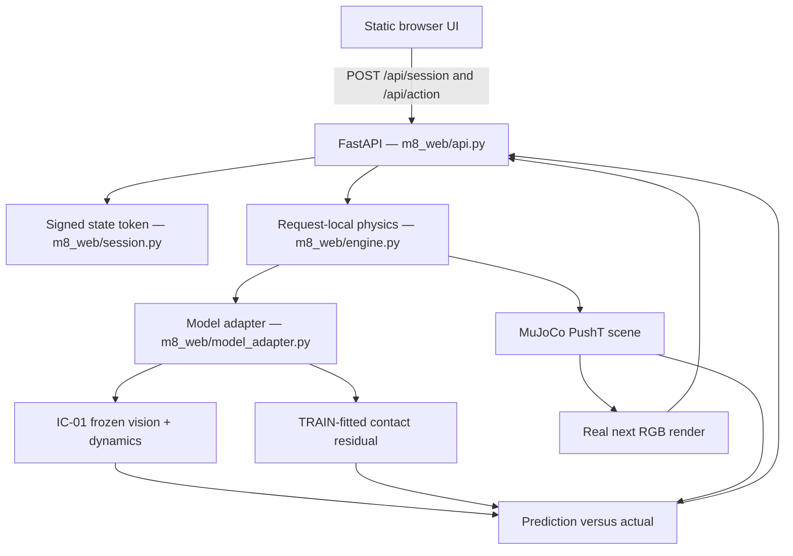

# Architecture

ActionWorld Lite couples a frozen visual physical-state predictor with a real MuJoCo reference environment. The web product is a **single FastAPI application**, serving a static browser UI and a bounded JSON API through the Vercel Container runtime.

## Components

## Action lifecycle

1. **Reset:** The server creates a new real `PushTEnv`, renders the first 256 × 256 RGB frame, takes one **unscored zero-action** 0.05 s physics step, and renders a second frame. The scored counter remains zero.
2. **Token:** A signed browser-carried snapshot contains the MuJoCo integration state, two downsampled genuine 64 × 64 RGB frames, sequence/count metadata, expiry and artifact fingerprint.
3. **Action:** The UI sends a signed token plus one of four directions and a 5/10/20 mm displacement. The API verifies the token and input bounds, then creates a new request-local MuJoCo environment.
4. **Inference:** IC-01 consumes only **RGB(t−1), RGB(t), action**. M6 uses IC-01's allowed derived predictions and the fitted residual. It never consults privileged future simulator state for its model input.
5. **Physical reference:** The environment runs **10 MuJoCo substeps** of 0.005 s, totaling 0.05 s per scored action. The server renders a *new* actual scene image.
6. **Comparison and continuation:** Predicted XY/yaw/contact and the real post-step state are scored. The response returns a new signed token with the updated physics integration state and rolled RGB pair.

## Physics, rendering and geometry

The simplified PushT-style scene contains an orange T-shaped object and a blue pusher, viewed by a fixed top camera. Physics integration occurs in MuJoCo, not in the trained model. The predictor receives stride-4 subsamples of 256 × 256 real renders, yielding 64 × 64 × 3 uint8 input frames; two RGB images are concatenated as a six-channel tensor.

The page displays a real RGB render **and a separate XY geometry diagram**. Predicted outlines are state coordinates, not pixelwise next-frame image synthesis. The current model provides one-step estimates; autonomous multi-step learned rollouts are not a validated claim.

## Stateless continuation and trust boundaries

The server uses an HMAC-SHA256-signed token rather than a session database. For this frozen scene, `mjSTATE_INTEGRATION` has **51 float64 elements**, and the token also carries the two real low-resolution RGB frames. Model checkpoints and fitted residual JSON stay server-side; the secret is an environment variable, not part of Git or any browser response.

A valid token may be replayed until it expires. **Signature verification prevents tampering, not single-use replay or global exactly-once processing.** The frontend serializes button clicks; no server-side durable nonce store is provided. Sessions expire after **15 minutes**, are limited to **64 scored actions**, and must be Reset afterward. Request-specific MuJoCo state is not shared between users; immutable model objects may be cached in the worker.

## Runtime and failure behavior

The published backend runs **Python 3.12, CPU PyTorch, MuJoCo, NumPy, FastAPI, and OSMesa** inside a Vercel Container. The native Python runtime was not used because the required headless-rendering shared library was missing from that path. On missing or mismatched frozen artifacts, invalid inference, or unavailable physics, the API fails closed rather than returning a fabricated prediction.

See [API](api.md), [deployment](deployment.md), and the [original production record](M8_STEP3_DEPLOYMENT.md).
